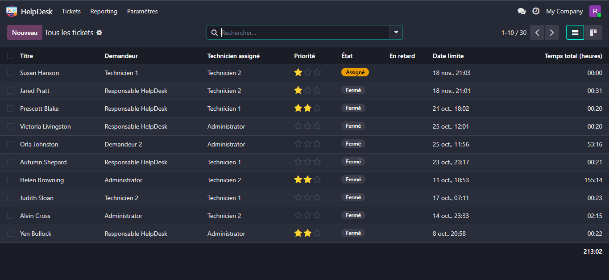
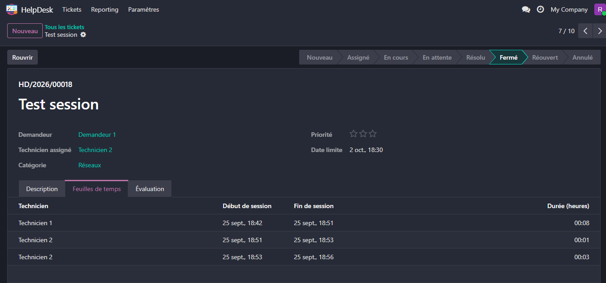
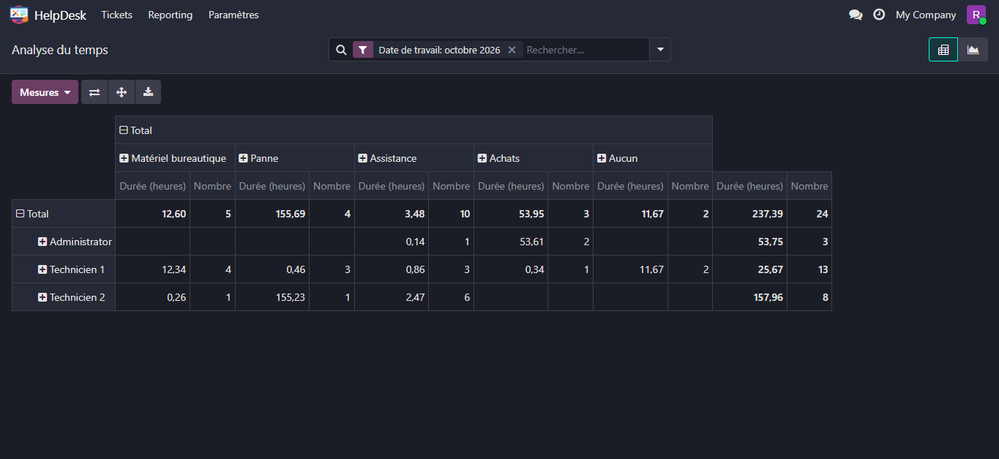

# HelpDesk Bayz

Environnement Docker Odoo 19 hébergeant le module **HelpDesk Bayz** (`bayz_helpdesk`) pour la gestion professionnelle des tickets de support internes.

## 🚀 Fonctionnalités principales (`bayz_helpdesk`)

- **Gestion des tickets** : création avec numérotation automatique (`HD/AAAA/00001`), assignation, vues Liste, Formulaire et Kanban interactif (glisser-déposer contrôlé par les droits), et chatter Odoo intégré.
- **Workflow contrôlé** : états *Nouveau, Assigné, En cours, En attente, Résolu, Fermé, Réouvert, Annulé* avec transitions et permissions strictes par rôle.
- **Suivi des SLA** : calcul automatique de la date limite selon la priorité (*Faible* : 7 j, *Moyenne* : 3 j, *Haute* : 24 h, *Urgent* : 6 h), recalcul à la réouverture et filtre des tickets en retard.
- **Feuilles de temps & Reporting** : démarrage/arrêt automatique des sessions de travail lors des transitions vers/hors *En cours*, vues Pivot et Graphique, et export Excel (`.xlsx`) filtrable par période, technicien et catégorie.
- **Catégories** : gestion des catégories avec unicité normalisée (insensible à la casse, aux accents et aux espaces superflus) et compteur de tickets associés.
- **Notifications & Évaluations** : notifications e-mail automatiques lors des changements d'état et évaluation de satisfaction unique (note de 1 à 5) par le demandeur après clôture.
- **Sécurité et Droits** : accès cloisonnés par groupes hiérarchiques (*Utilisateur*, *Technicien*, *Responsable*), règles d'enregistrement (`ir.rule`) et contrôles métier.

## 📸 Aperçu

### Liste des tickets


### Formulaire de ticket et workflow


### Analyse du temps (vue Pivot)


## 📁 Structure du dépôt

```text
.
├── compose.yaml               # Orchestration Docker (Odoo 19, PostgreSQL 17, Mailpit)
├── dockerfile                 # Image Odoo personnalisée avec installation de requirements.txt
├── requirements.txt           # Dépendances Python supplémentaires (openpyxl)
├── .env                       # Variables d'environnement Docker et chemins locaux
├── docs/
│   └── screenshots/           # Captures d'écran de l'application
├── odooconf/
│   └── odoo.conf              # Configuration du serveur Odoo
├── custom-addons/
│   └── bayz_helpdesk/         # Module Odoo HelpDesk Bayz
└── commande.md                # Aide-mémoire complémentaire des commandes CLI Odoo
```

## ⚙️ Prérequis & Configuration

- **Docker** et **Docker Compose**
- Un fichier `.env` à la racine définissant notamment :
  - `ODOO_VERSION=19.0`, `POSTGRES_VERSION=17-alpine`
  - `ODOO_PORT=8034`
  - `DB_CONTAINER_NAME=postgres-v19-helpdesk`, `ODOO_CONTAINER_NAME=odoo-v19-helpdesk`
  - `POSTGRES_DB`, `POSTGRES_USER`, `POSTGRES_PASSWORD`
  - `CONFIG_PATH=./odooconf`, `ADDONS_PATH=./custom-addons`
  - `ENTREPRISE_PATH` (chemin local vers les addons Odoo Enterprise montés dans `/mnt/entreprise-addons`)
- Dépendance Python `openpyxl` (installée automatiquement lors du build via [dockerfile](dockerfile) et [requirements.txt](requirements.txt)).

## 🌐 Services et ports exposés

| Service | Conteneur | Port hôte | Description |
|---|---|---|---|
| **Odoo 19** | `odoo-v19-helpdesk` | `8034` | Interface web Odoo (`http://localhost:8034`), démarrée avec `--dev xml,qweb` |
| **PostgreSQL 17** | `postgres-v19-helpdesk` | `5439` | Base de données PostgreSQL |
| **Mailpit** | `mailpit` | `8025` / `1025` | Interface web de capture d'e-mails (`http://localhost:8025`) et serveur SMTP (`1025`) |

## 🛠️ Commandes utiles

### 🐳 Gestion des conteneurs Docker

```bash
# Construire l'image (incluant requirements.txt) et démarrer les conteneurs
docker compose up -d --build

# Démarrer en supprimant les conteneurs orphelins (après modification de compose.yaml)
docker compose up -d --remove-orphans

# Redémarrer les conteneurs actifs
docker compose restart

# Arrêter proprement les conteneurs (sans les supprimer)
docker compose stop

# Arrêter et supprimer les conteneurs et réseaux
docker compose down
```

### 🧩 Commandes Odoo (`bayz_helpdesk`)

> Remplacer `odoo-helpdesk` par le nom exact de votre base de données si différent (voir aussi [commande.md](commande.md)).

```bash
# Mettre à jour le module bayz_helpdesk (sans conflit sur le port HTTP)
docker exec odoo-v19-helpdesk odoo -c /etc/odoo/odoo.conf -d odoo-helpdesk -p 0 -u bayz_helpdesk --stop-after-init

# Mettre à jour le module et exécuter toute la suite de tests bayz_helpdesk
docker exec odoo-v19-helpdesk odoo -c /etc/odoo/odoo.conf -d odoo-helpdesk -u bayz_helpdesk --test-tags /bayz_helpdesk --stop-after-init --http-port=8070

# Ouvrir un shell Odoo interactif sur la base
docker exec -it odoo-v19-helpdesk odoo shell -c /etc/odoo/odoo.conf -d odoo-helpdesk
```
